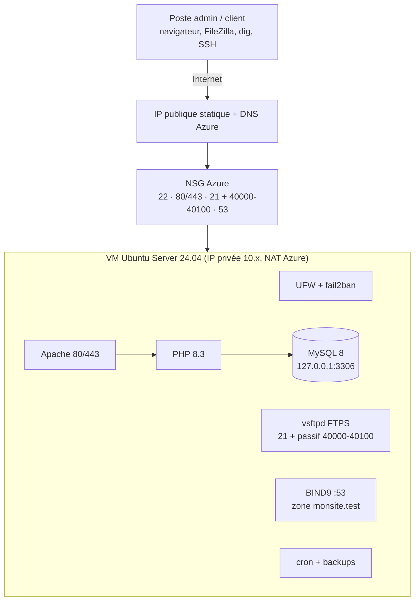
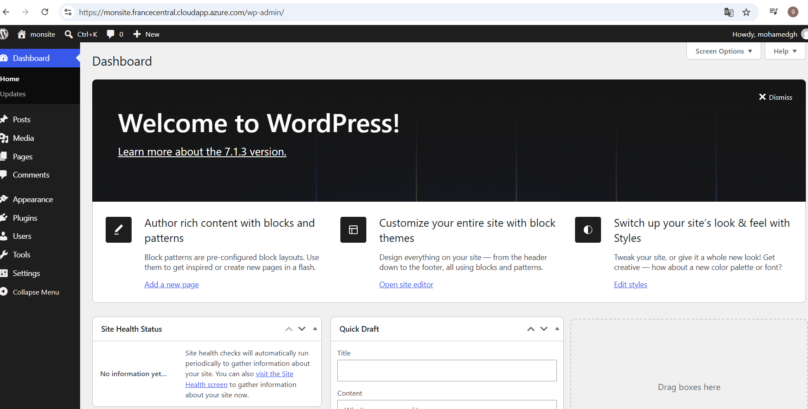
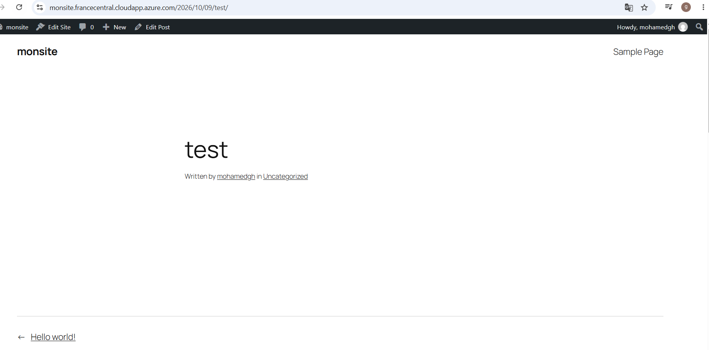

# ☁️ Hébergement web LAMP + WordPress sur Microsoft Azure


> Laboratoire personnel qui reproduit le quotidien d'un **hébergeur web** : déployer, sécuriser, sauvegarder et **dépanner** un serveur hébergeant le site d'un client.

**Statut :** projet terminé et documenté. L'environnement Azure a été démantelé après les tests pour maîtriser les coûts (les captures et configurations servent de preuves).

---

## 🎯 Objectif
Construire un mini-hébergeur complet sur le cloud : une VM Linux hébergeant un site WordPress en HTTPS, un accès FTPS pour le client, une zone DNS gérée par mon propre serveur, des sauvegardes automatisées dont la restauration a été testée, et 10 incidents types simulés puis résolus.

## 🏗️ Architecture



| Brique | Technologie | Rôle |
|---|---|---|
| Cloud | Microsoft Azure (VM, NSG, IP publique) | Infrastructure |
| Système | Ubuntu Server 24.04 LTS | Serveur Linux |
| Web | Apache 2.4 + PHP 8.3 | Virtual host, modules, logs |
| Base de données | MySQL 8 | Base et utilisateur dédiés |
| CMS | WordPress | Site client |
| Transfert | vsftpd (FTPS) | Accès client chrooté, TLS obligatoire |
| DNS | BIND9 | Zone autoritaire A / CNAME / MX / TXT / NS / SOA |
| HTTPS | Let's Encrypt (certbot) | Certificat reconnu, renouvellement auto |
| Sécurité | NSG, UFW, fail2ban, SSH par clé | Défense en profondeur |
| Sauvegardes | mysqldump, tar, cron | Quotidien, rétention 7 jours |

## ✅ Ce qui a été réalisé
- Déploiement d'une VM Ubuntu 24.04 sur Azure (IP publique statique, nom DNS, clé SSH)
- Filtrage à **deux niveaux** : NSG Azure + UFW ; SSH, FTP et DNS restreints à une IP
- Apache avec virtual host, PHP configuré pour WordPress, MySQL sécurisé (écoute locale uniquement)
- WordPress installé en **HTTPS** avec certificat Let's Encrypt et renouvellement automatique
- **FTPS** avec compte client isolé (chroot, sans shell) et mode passif derrière le NAT (`pasv_address`)
- Zone DNS **BIND9 autoritaire**, récursion désactivée (anti-amplification)
- Sauvegardes quotidiennes (cron), rotation 7 jours, **restauration testée**
- Durcissement : fail2ban, SSH par clé uniquement, root désactivé, `ServerTokens Prod`
- Maîtrise des coûts : budget d'alerte, arrêt automatique, désallocation, nettoyage final

## 🛠️ Incidents simulés et résolus (extrait)
| # | Incident | Symptôme | Résolution |
|---|---|---|---|
| 1 | MySQL arrêté | « Error establishing a database connection » | `systemctl start mysql` |
| 3 | `.htaccess` invalide | Erreur 500 | Lecture du `error.log`, correction |
| 8 | Règle NSG web supprimée | Timeout externe, `localhost` OK | Network Watcher, règle recréée |
| 9 | `pasv_address` retiré | FTP : liste de fichiers bloquée | IP publique rétablie dans vsftpd |
| 10 | Port 80 fermé | `certbot renew` en échec | Port rouvert, dry-run validé |

➡️ Tableau complet des 10 incidents : [`docs/05-incidents.md`](docs/05-incidents.md)

## 🧩 Difficultés rencontrées et solutions
<!-- Remplace par TES vrais problèmes (3 à 5) : symptôme → cause → correctif -->
1. **FTP : liste de fichiers bloquée sur Azure** → la VM annonçait son IP privée `10.x` en mode passif (NAT) → `pasv_address=IP_PUBLIQUE` + plage 40000-40100 ouverte dans NSG **et** UFW.
2. **Site injoignable alors que `curl localhost` répond** → règle NSG manquante, UFW non en cause → méthode de diagnostic « dans la VM puis depuis l'extérieur ».
3. **Perte d'accès SSH potentielle** → IP personnelle dynamique et règle NSG restreinte → mise à jour de la règle à chaque session.

## 📁 Structure du dépôt
```
lamp-wordpress-azure-hosting-lab/
├── README.md
├── docs/
│   ├── 01-azure-vm-reseau.md        # VM, NSG, UFW, Apache
│   ├── 02-lamp-wordpress-https.md   # PHP, MySQL, WordPress, Let's Encrypt
│   ├── 03-ftps-dns.md               # vsftpd (FTPS) et BIND9
│   ├── 04-sauvegardes.md            # sauvegardes, cron, restauration
│   └── 05-incidents.md              # 10 incidents simulés
├── config/                          # configurations (sans secrets)
│   ├── monsite.conf  vsftpd.conf  named.conf.options  named.conf.local
│   ├── db.monsite.test  jail.local  99-hardening.conf
│   └── php-wordpress.ini.txt  wp-config.EXAMPLE.php
├── scripts/
│   ├── azure-cli-commands.sh  ufw-setup.sh
│   └── backup_monsite.sh  restore_test.sh
└── screenshots/                     # captures 1 à 12
```

## 🚀 Reproduire le projet
1. Créer la VM et le NSG : [`scripts/azure-cli-commands.sh`](scripts/azure-cli-commands.sh)
2. Suivre les documents `docs/01` à `docs/04` dans l'ordre
3. Adapter les valeurs d'exemple (`monsite-gharbi`, `IP_PUBLIQUE`, `MON_IP`, mots de passe) à votre environnement
4. Provoquer les incidents de `docs/05` pour s'entraîner au diagnostic

## 🔐 Sécurité du dépôt
Aucun mot de passe, clé privée, `wp-config.php` réel, ni identifiant d'abonnement Azure n'est publié (voir `.gitignore`). Les valeurs sont des exemples.

## 📸 Aperçu






## 📚 Compétences démontrées
Microsoft Azure (VM, NSG, Network Watcher) · Linux Ubuntu · Apache · PHP · MySQL · WordPress · FTP/FTPS · DNS (BIND9) · SSL/TLS (Let's Encrypt) · cron · UFW · fail2ban · diagnostic par les logs · documentation technique.

## 🔭 Améliorations possibles
Supervision (Azure Monitor), sauvegardes externes (Azure Backup / Blob Storage), WAF, Infrastructure as Code (Terraform / Bicep), haute disponibilité, domaine réel avec délégation DNS.

## 👤 Auteur
**<Mohamed gharbi>** 
[LinkedIn](https://www.linkedin.com/in/<ton-profil>) 

## 📄 Licence
[MIT](LICENSE)
